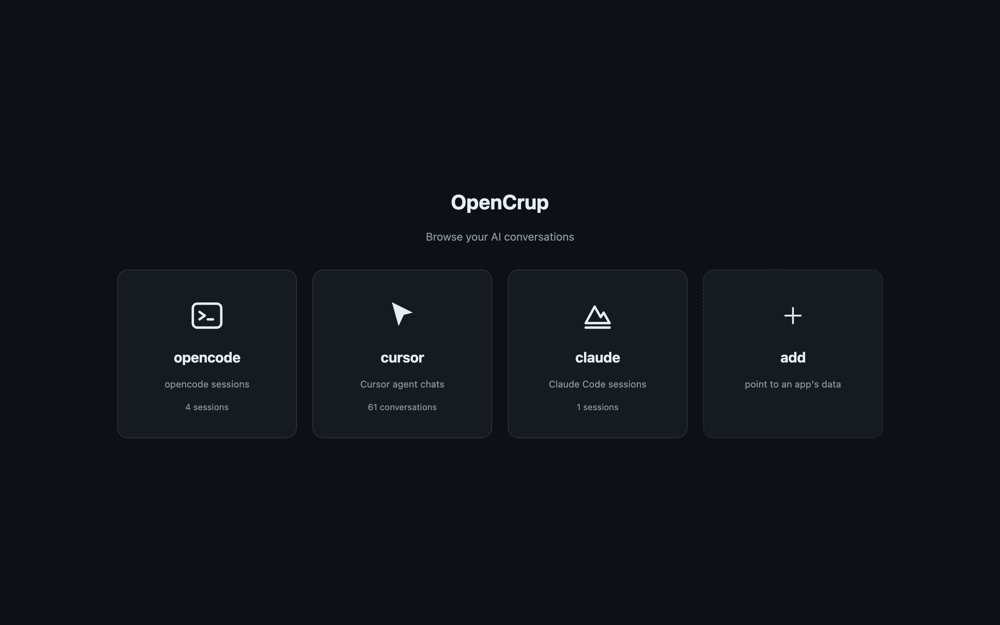
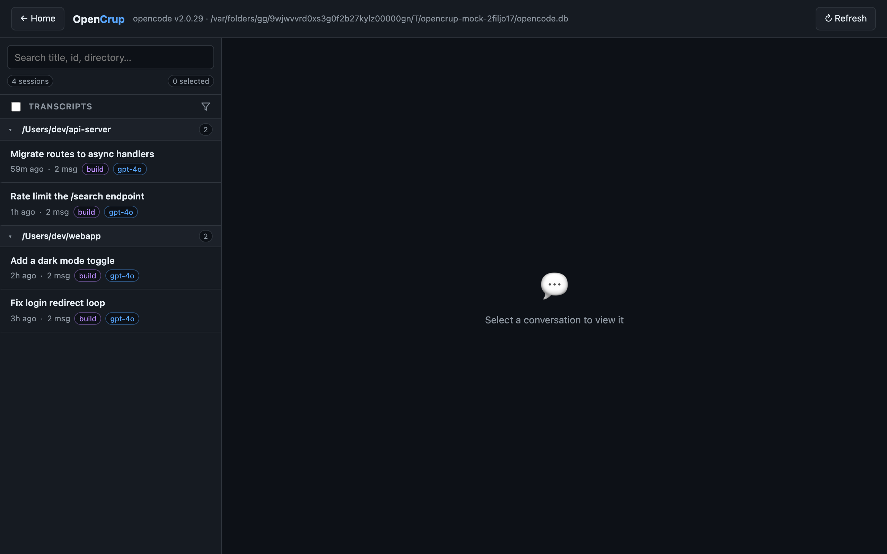

# OpenCrup

A local viewer and editor for [opencode](https://opencode.ai) and Cursor agent transcripts.



Pick a source and open a conversation. Only sources that exist on this machine are shown. A `+` lets you point at a Cursor install the scan missed.

## What it does

Browse, search, and group conversations by project. Read markdown, collapsed thinking blocks, tool calls, and system events. Edit or delete individual messages. Select a range and delete, archive, or unarchive in bulk. Export a session as JSON.

You can also move a conversation between opencode and Cursor. It is converted to the target format (SQLite or `.jsonl`) and opened in that view. Moving into Cursor writes the `.jsonl` transcript **and** injects the conversation into Cursor's own stores (composer record, message bubbles, workspace sidebar, search index) so it lists and loads in the real Cursor app immediately — not just after Cursor indexes the file. The real app renders each assistant reply from the bubble's text and tool-call data, so those are written per message (visible text, tool calls, and the render gate).

## Run

Requires Python 3. No install step.

```bash
./start.sh            # http://127.0.0.1:4321
./start.sh -p 8080    # custom port
./start.sh -H 0.0.0.0 # bind address
./start.sh -d /path/to/opencode.db
```

Or `python3 server.py`.

| Variable | Default | Meaning |
|---|---|---|
| `PORT` | `4321` | HTTP port |
| `HOST` | `127.0.0.1` | Bind address |
| `OPENCODE_DB` | `~/.local/share/opencode/opencode.db` | opencode database |
| `CURSOR_PROJECTS` | `~/.cursor/projects` | Cursor transcripts root |

The server binds to localhost by default. It uses SQLite WAL mode and short transactions, so it can run while opencode is open.

## Dev mode

`dev_mock.py` starts a second server against a temporary database of fake opencode sessions. Your real conversations are not read. The database is removed when the process exits.

```bash
python3 dev_mock.py          # http://127.0.0.1:4322
python3 dev_mock.py -p 5000
```



## Deleting a Cursor conversation

A Cursor conversation is stored in more than the transcript file. Deleting one from OpenCrup removes it from all of these:

| Store | Path |
|---|---|
| Transcript | `~/.cursor/projects/<slug>/agent-transcripts/<uuid>/` |
| Encrypted reasoning | `~/.cursor/chats/<hash>/<uuid>/store.db` |
| Search index | `conversation-search.db` |
| Cloud-sync copy | `AgentStores/cursor_agent_stores/<uuid>/` |
| UI state | `state.vscdb` |
| Telemetry | `ai-tracking/ai-code-tracking.db` |

If Cursor still has a copy on its servers, a later sync can bring the conversation back. That copy is outside this app.

The same purge is available from the command line:

```bash
python3 purge_cursor.py <uuid-or-prefix> [--dry-run]
```

## Layout

| File | Role |
|---|---|
| `server.py` | HTTP server, opencode database, Cursor transcript parsing, purge |
| `public/index.html` | Frontend |
| `purge_cursor.py` | Standalone purge CLI |
| `dev_mock.py` | Mock opencode data for local development |
| `start.sh` | Launcher |

Python standard library only (`http.server`, `sqlite3`). No package install and no build step.

## API

opencode routes:

- `GET` / `POST /api/sessions`
- `GET` / `PATCH` / `DELETE /api/sessions/:id`
- `PATCH` / `DELETE /api/messages/:id`
- `POST /api/sessions/:id/move-to-cursor` with `{directory, delete_original}`

Cursor routes use the same shapes under `/api/cursor`, plus:

- `POST /api/cursor/sessions/:id/purge`
- `POST /api/cursor/sessions/:id/move-to-opencode` with `{directory, delete_original}`

A Cursor session id is `<project-slug>::<transcript-uuid>`.

Sources:

- `GET /api/sources` — which sources were found, and how many sessions each has
- `POST /api/sources/cursor` — save a Cursor path the scan missed

## License

MIT. See [LICENSE](LICENSE).
